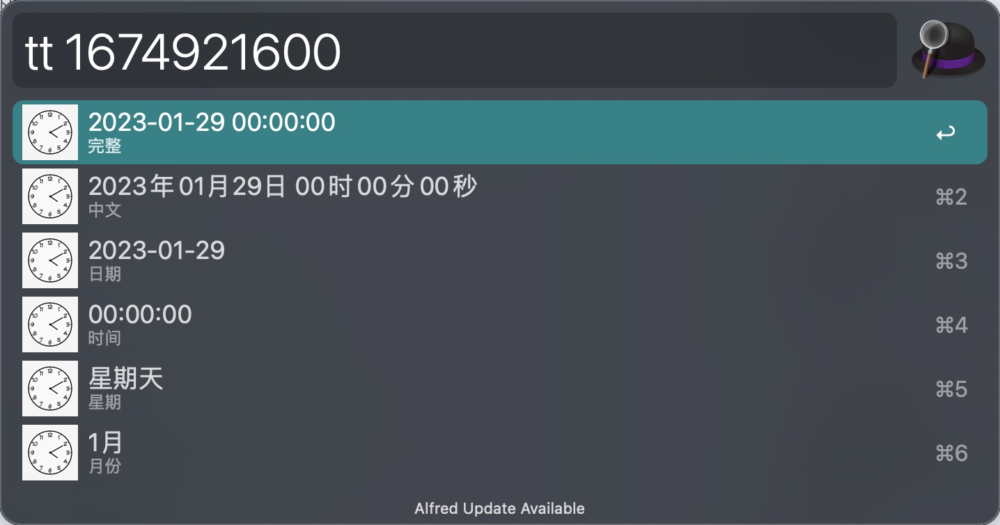
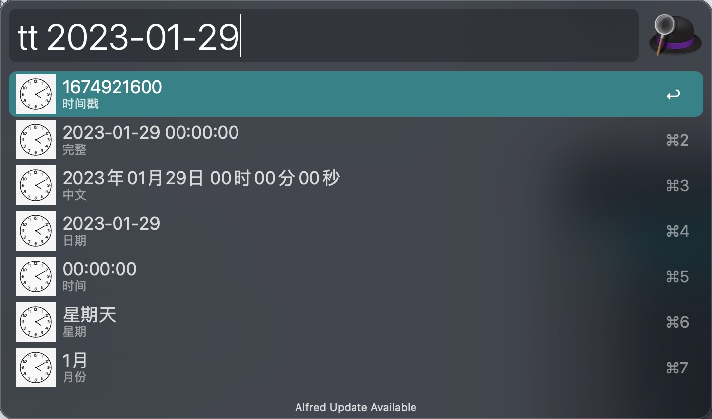
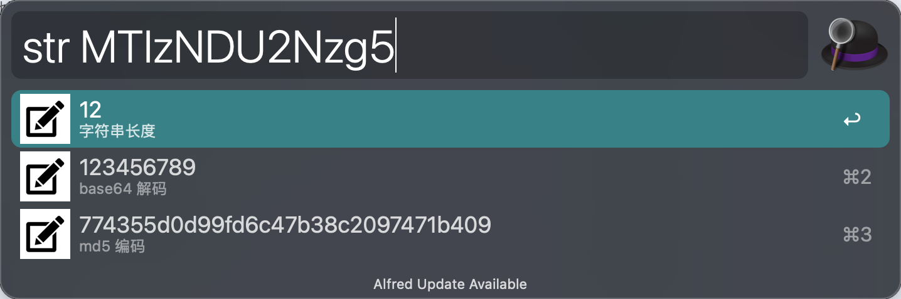
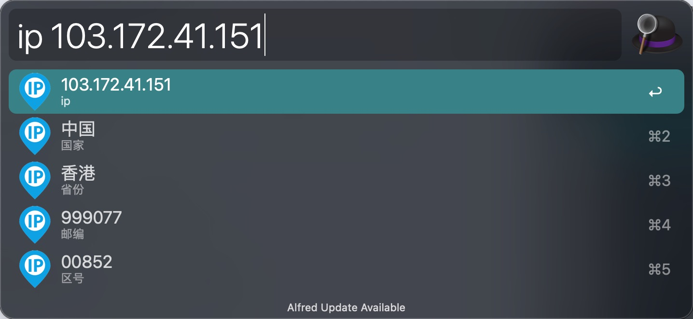
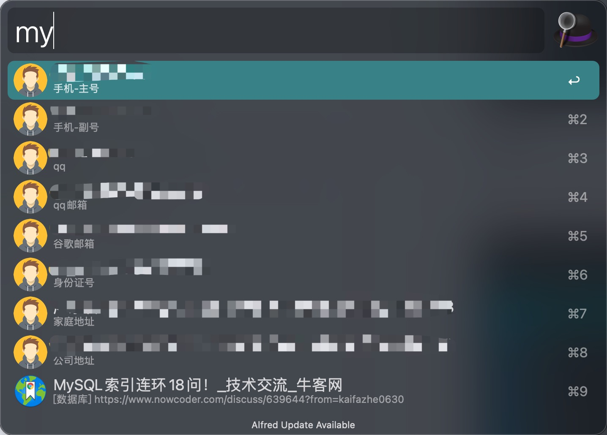
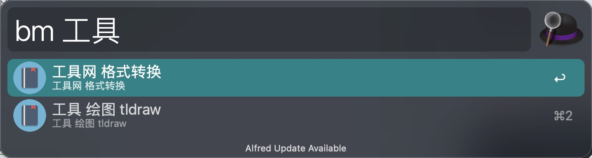
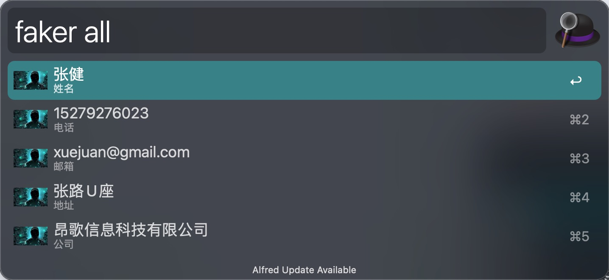
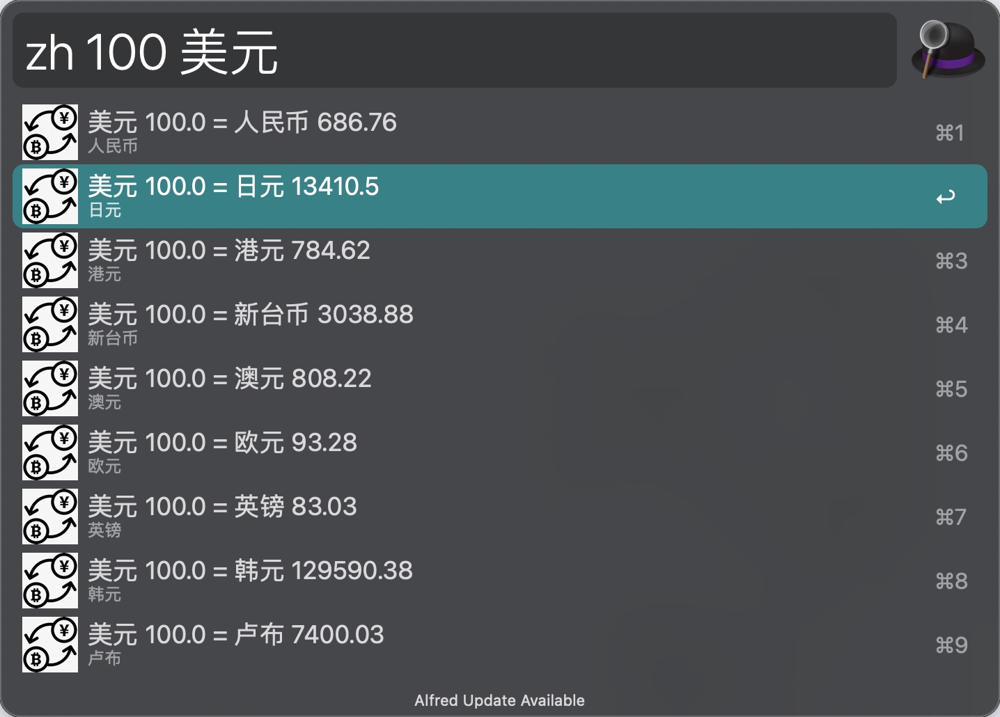

# Alfred Workflow Scripts

一套用于 [Alfred](https://www.alfredapp.com/) 的 Python 脚本集合，通过 Alfred Script Filter 提供高效的日常工作流。

> 本项目仅包含脚本文件，请自行在 Alfred 中创建 Workflow 并导入对应脚本。

## 安装

项目使用 [uv](https://docs.astral.sh/uv/) 管理 Python 3.12 和项目内 `.venv`：

```bash
uv sync
```

所有脚本使用通用的 shebang，由 uv 自动定位项目环境：

```text
#!/usr/bin/env -S uv run --frozen --quiet
```

因此需要先确保 `uv` 已安装，并在项目根目录运行 `uv sync`。Alfred 可直接引用脚本文件，无需在 Workflow 中额外配置解释器路径。

---

## 目录

- [基础工具](#基础工具)
  - [时间工具](#时间工具)
  - [字符串工具](#字符串工具)
  - [请求信息解析](#请求信息解析)
  - [iMessage 验证码](#imessage-验证码)
- [查询工具](#查询工具)
  - [IP 查询](#ip-查询)
  - [个人信息](#个人信息)
  - [书签查找](#书签查找)
- [生成工具](#生成工具)
  - [个人信息随机生成](#个人信息随机生成)
- [翻译工具](#翻译工具)
  - [翻译（Google Translate）](#翻译google-translate)
  - [AI 翻译 & 词典](#ai-翻译--词典)
  - [AI 变量名生成](#ai-变量名生成)
- [金融工具](#金融工具)
  - [汇率转换](#汇率转换)
- [书签管理](#书签管理)
  - [Linkding 书签管理](#linkding-书签管理)
- [配置说明](#配置说明)
- [项目结构](#项目结构)

---

## 基础工具

### 时间工具

[代码](tools/time_tools.py) | 处理器链模式

对时间戳和格式化时间进行互相转换，同时支持 MongoDB ObjectId 的时间提取。

**输入 → 输出：**

| 输入 | 输出 | 说明 |
|------|------|------|
| 时间戳（10/13 位） | 完整时间、中文时间、日期、时间、星期、月份 | 自动识别 |
| 格式化时间（如 `2024-01-01` 或 `12:00:00`） | 时间戳 + 上述所有格式化时间 | 含 `-` 或 `:` 即触发 |
| MongoDB ObjectId（24 位 hex） | 该 ObjectId 的生成时间 | 自动识别 |




---

### 字符串工具

[代码](tools/string_tools.py) | 单一处理器

对输入字符串进行解析，自动输出以下结果：

- **字符串长度**：字符数
- **Base64 编解码**：自动判断 — 能解码则解，不能则编
- **MD5 哈希**：32 位小写



---

### 请求信息解析

[代码](tools/parse_request_info.py) | 单一处理器

从包含 JSON 的日志文本中自动提取 HTTP 请求/响应信息，支持解析 `originErrorInfo` 格式的数据。

**输入**：包含 JSON 的日志文本  
**输出**：请求链接、请求头、返回头、请求数据、返回数据（结构化展示）

常用于从错误日志中快速提取接口调用详情。

---

### iMessage 验证码

[代码](tools/imessage_tools.py) | 单一处理器

自动读取本地 iMessage 数据库（`chat.db`），提取最近 2 分钟内收到的验证码。

**输入**：无（直接调用即返回）  
**输出**：最近 2 分钟内的验证码（6 位数字），若无则提示"未获取到"

> 需要 `IMESSAGE_DP_PATH` 配置指向正确的 `chat.db` 路径。

---

## 查询工具

### IP 查询

[代码](tools/ip_tools.py) | 单一处理器

通过 [ip138 API](https://www.ip138.com/) 查询 IP 地址的地理信息。

**输入 → 输出：**

| 输入 | 输出 |
|------|------|
| IP 地址（如 `8.8.8.8`） | IP、国家、省份、城市、区、运营商、邮编、区号 |
| `my` | 查询本机公网 IP 及其归属信息 |

> 需要配置 `IP_138.token`。



---

### 个人信息

[代码](info/my_info.py) | 单一处理器

从配置文件读取并快速检索个人信息。

**输入 → 输出：**

| 输入 | 输出 |
|------|------|
| 空（无输入） | 所有个人信息条目 |
| 关键词（如 `qq`、`邮箱`、`手机`） | 匹配的条目列表，支持模糊匹配 |

> 需在 `config.py` 中配置 `MY_INFO` 字典。



---

### 书签查找

[代码](info/my_bookmarks.py) | 单一处理器

通过模糊匹配快速搜索常用书签/网站链接。

**输入 → 输出：**

| 输入 | 输出 |
|------|------|
| 空（无输入） | 所有书签 |
| 关键词（如 `天眼`、`b站`） | 匹配的书签列表，支持多词模糊搜索 |

> 需在 `config.py` 中配置 `MY_BOOKMARKS` 字典。



---

## 生成工具

### 个人信息随机生成

[代码](tools/faker_tools.py) | 单一处理器

使用 [Faker](https://faker.readthedocs.io/) 随机生成中文个人信息（zh_CN locale）。

**输入 → 输出：**

| 输入 | 输出数量 | 说明 |
|------|---------|------|
| `姓名` / `电话` / `邮箱` / `地址` / `公司` | 10 条 | 单独类型生成 10 条 |
| `all` | 每种 1 条 | 汇总所有类型 |
| 其他输入 | 不匹配时无输出 | — |



---

## 翻译工具

### 翻译（Google Translate）

[代码](tools/translation_tools.py) | 单一处理器

基于 [translatepy](https://github.com/Animenosekai/translate) 的 Google Translate 翻译工具，支持中英日德西互译。

**输入 → 输出：**

| 输入 | 行为 |
|------|------|
| 纯文本 | 自动检测语言：中文 → 英文，其他 → 中文 |
| `中文` / `英文` / `日文` / `德语` / `西班牙语` + 文本 | 指定目标语言翻译 |

**返回值：** 翻译结果、源语言 → 目标语言标注、服务商

> 支持通过 `PROXY_SETTING` 配置代理。

---

### AI 翻译 & 词典

[代码](ai/translation.py) | 多线程并发

基于大语言模型的智能翻译和词典查询工具，支持多个 AI 后端。

**智能分流：**
- **单行/短文本** → 自动识别句子 vs 单词：
  - 句子（含空格、多词）→ **翻译模式**（中英互译）
  - 单词（不含空格）→ **词典模式**（音标、词性、释义、时态变化、搭配、例句）
- **AI 后端：** Deepseek、Ollama (qwen2.5)、ModelScope (Qwen3-Coder)、NVIDIA NIM (Llama Nemotron)

**词典模式输出：** 单词、音标、词性、释义、词形变化、搭配、例句

> 需配置对应 AI 后端的 API Key。

---

### AI 变量名生成

[代码](ai/generate_name.py) | 多线程并发

根据中文描述，使用 AI 生成符合编程命名规范的变量名和函数名。

**输入：** 中文描述（如"获取商品列表"、"计算两个数的和"）  
**输出：** 下划线命名（snake_case）和小驼峰命名（camelCase）格式的变量名和函数名

**支持后端：** Deepseek、Ollama、ModelScope

> 需配置对应 AI 后端的 API Key。

---

## 金融工具

### 汇率转换

[代码](tools/exchange_rate_tools.py) | 单一处理器

基于 [APILayer Currency Data](https://apilayer.com/) 的实时汇率转换工具。

**输入 → 输出：**

| 输入格式 | 行为 | 示例 |
|---------|------|------|
| `<币种>` | 显示该币种的 ISO 代码 | `人民币` → `CNY` |
| `<币种> <金额>` | 转换为所有已知币种 | `人民币 100` → 各币种等值金额 |
| `<币种_1> <币种_2> <金额>` | 指定单向转换 | `人民币 美元 100` → 仅显示美元结果 |

**支持币种：** 人民币、美元、日元、港元、新台币、澳元、欧元、英镑、韩元、卢布、卢比、瑞郎、新西兰元、缅币、越南盾、泰铢、加元

> 需要 API Key（`apikey`，硬编码在代码中）。




---

## 书签管理

### Linkding 书签管理

[目录](linkding/) | 两个脚本配合

集成 [Linkding](https://github.com/sissbruecker/linkding) 自托管书签服务的工具。

- **`linkding-refresh.py`**：从 Linkding 服务端同步书签数据到本地缓存（`bookmarks.json`）
  - 需要环境变量：`linkding_host`、`linkding_token`、`alfred_workflow_cache`
- **`linkding-helper.py`**：搜索本地缓存的书签，支持按标题、URL 和标签检索
  - `#标签名` 可过滤指定标签的书签

> 通常配置两个 Alfred Workflow：一个定时刷新缓存，一个用于快速搜索书签。

---

## 配置说明

复制 `default_config.py` 为 `config.py`，按需填写：

| 配置项 | 用途 | 对应工具 |
|--------|------|---------|
| `MY_INFO` | 个人信息的键值对字典 | 个人信息 |
| `MY_BOOKMARKS` | 书签（分类 + 标题 + URL） | 书签查找 |
| `IP_138.token` | ip138 API Token | IP 查询 |
| `APILAYER_API_KEY` | APILayer 汇率 API Key | 汇率转换 |
| `PROXY_SETTING` | HTTP/HTTPS 代理地址 | 翻译工具 |
| `OLLAMA_HOST` | Ollama 服务地址 | AI 翻译、AI 变量名 |
| `DEEPSEEK_API_KEY` | DeepSeek API Key | AI 翻译、AI 变量名 |
| `MODEL_SCOPE_API_KEY` | ModelScope API Key | AI 翻译、AI 变量名 |
| `NVIDIA_NIM_API_KEY` | NVIDIA NIM API Key | AI 翻译 |
| `IMESSAGE_DP_PATH` | iMessage chat.db 路径 | iMessage 验证码 |

---

## 项目结构

```
my-workflows/
├── .venv/                     # uv 创建的项目虚拟环境（不纳入版本管理）
├── .python-version            # Python 3.12
├── pyproject.toml             # 项目依赖
├── uv.lock                    # 依赖锁定文件
├── ai/                        # AI 相关工具
│   ├── translation.py         #   AI 翻译 & 词典
│   ├── generate_name.py       #   AI 变量名生成
│   ├── utils.py               #   AI 后端封装（Ollama/Deepseek/ModelScope/NVIDIA）
├── info/                      # 个人信息与书签
│   ├── my_info.py             #   个人信息查询
│   └── my_bookmarks.py        #   书签查找
├── linkding/                  # Linkding 书签管理
│   ├── linkding-refresh.py    #   书签同步
│   └── linkding-helper.py     #   书签搜索
├── public/                    # 公共基础设施
│   ├── base.py                #   查询处理器基类（QueryBase + QueryHandlerAbstract）
│   └── thread_base.py         #   多线程并发版本基类
├── spider/                    # 爬虫（暂无）
├── tests/                      # 测试文件
│   ├── __init__.py
│   └── test_translation.py    #   翻译功能测试脚本
├── tools/                     # 工具集合
│   ├── time_tools.py          #   时间工具
│   ├── ip_tools.py            #   IP 查询
│   ├── string_tools.py        #   字符串工具
│   ├── faker_tools.py         #   个人信息随机生成
│   ├── exchange_rate_tools.py #   汇率转换
│   ├── translation_tools.py   #   翻译工具（Google Translate）
│   ├── imessage_tools.py      #   iMessage 验证码
│   └── parse_request_info.py  #   请求信息解析
├── img/                       # 截图素材
├── config.py                  # 用户配置（不纳入版本管理）
├── default_config.py          # 默认配置模板
└── README.md
```

## 架构说明

所有工具遵循统一的处理器模式：

- **`QueryBase`**（`public/base.py`）— 串行处理器链，按注册顺序匹配并返回第一个可用结果
- **`QueryThreadBase`**（`public/thread_base.py`）— 多线程并发处理器，所有匹配的处理器并发执行后合并结果
- **`QueryHandlerAbstract`** — 处理器基类，需实现 `is_available(query)` 和 `get_result(query)`

每个工具脚本接收 Alfred 传入的查询字符串（`sys.argv[1]`），输出 JSON 格式的 `{"items": [...]}` 结果，供 Alfred Script Filter 展示。
